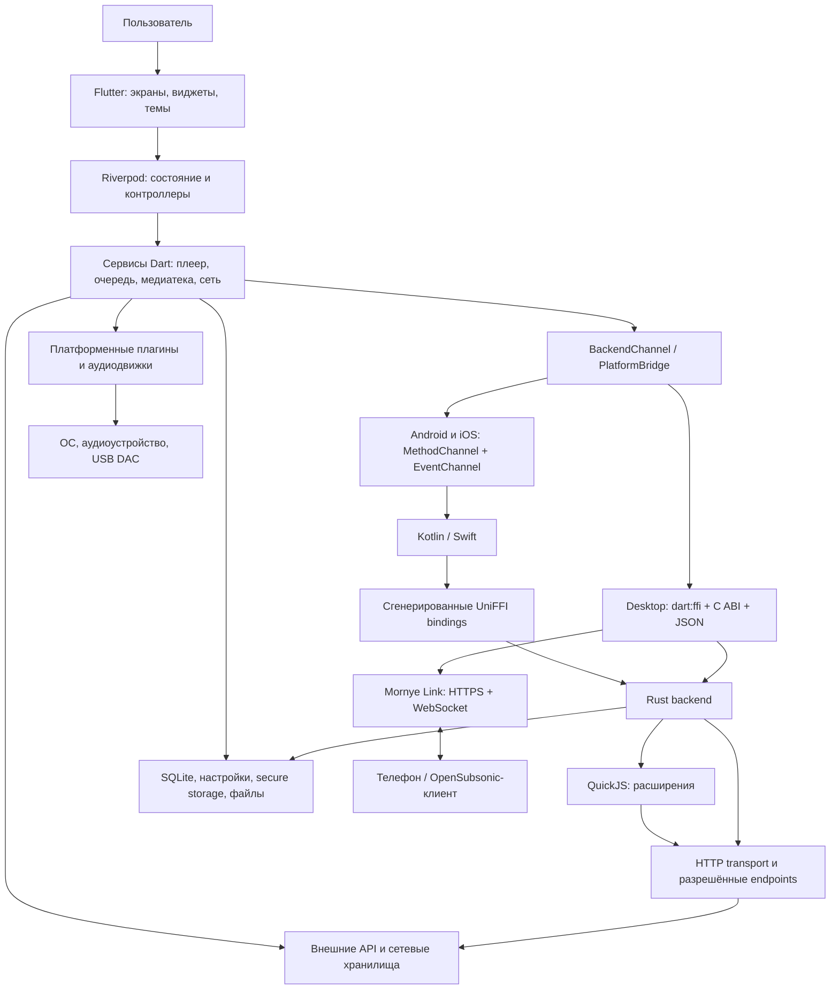
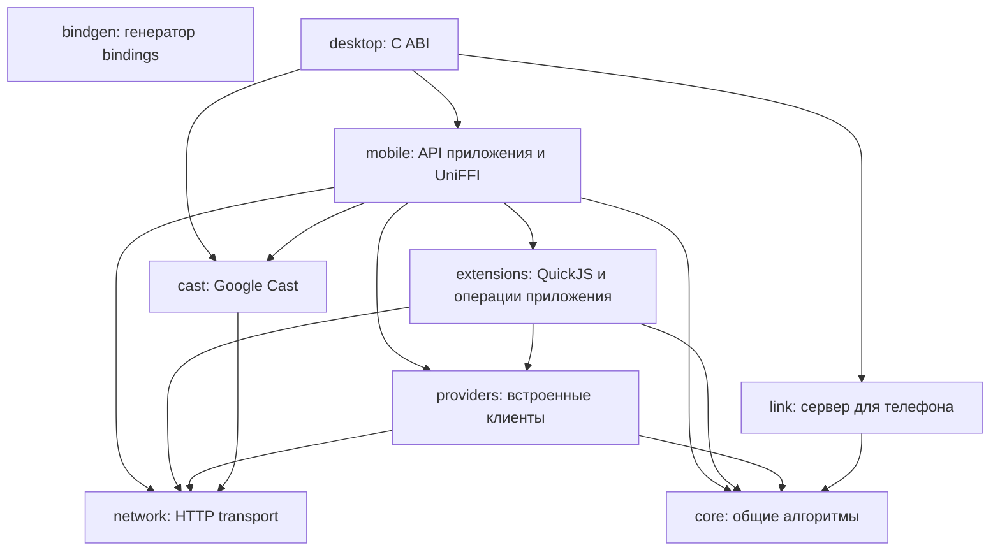
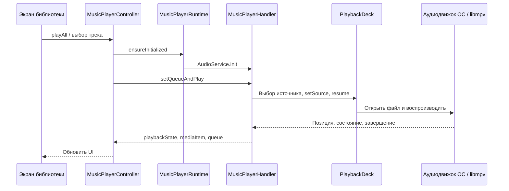
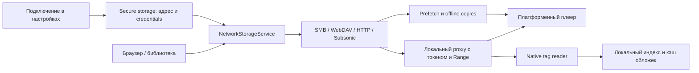

# LibreMusic / Mornye: архитектура, компоненты и развёртывание

Документ описывает код, импортированный из Mornye, на коммите `45df9860`, версия приложения `5.3.1+167`. Дата обзора: 9 ноября 2026 года. Репозиторий форка называется LibreMusic, но внутри исходников сохранены имя Mornye, пакеты, идентификаторы и адреса upstream.

Это обзор реализации в данном checkout. Наличие внешнего API в коде не означает, что его доступность проверена. Инструкции сборки сверены с исходниками и CI, но сами сборки при подготовке документа не выполнялись. Некоторые README отстают от кода: например, фактический Cargo workspace содержит также `link` и `cast`, а версия `dart_smb2` определяется `pubspec.yaml`, а не текстом NETWORK_STORAGE.md.

## Содержание

1. [Что представляет собой проект](#1-что-представляет-собой-проект)
2. [Общая схема](#2-общая-схема)
3. [Технологии и зависимости](#3-технологии-и-зависимости)
4. [Карта компонентов](#4-карта-компонентов)
5. [Основные сценарии работы](#5-основные-сценарии-работы)
6. [Внешние сервисы](#6-внешние-сервисы)
7. [Протоколы и форматы](#7-протоколы-и-форматы)
8. [Хранение данных](#8-хранение-данных)
9. [Развёртывание и сборка](#9-развёртывание-и-сборка)
10. [CI, релизы и подготовка форка](#10-ci-релизы-и-подготовка-форка)
11. [Проверка и диагностика](#11-проверка-и-диагностика)
12. [Навигация по исходникам](#12-навигация-по-исходникам)

## 1. Что представляет собой проект

Mornye представляет собой музыкальное приложение для Android, iOS, Linux, macOS и Windows. Оно объединяет проигрыватель, локальную медиатеку, сетевые источники, загрузки через расширения, обработку метаданных, тексты песен и инструменты анализа аудио.

Главная архитектурная особенность: Rust backend является библиотекой внутри приложения. Для прослушивания локальной музыки не требуется поднимать отдельный API-сервер, PostgreSQL, Redis или облачную учётную запись. Flutter отвечает за интерфейс и координацию, Rust за значительную часть обработки данных, расширения и сетевые операции, а платформенный код связывает приложение с ОС и аудиоустройствами.

При этом есть три разных вида сетевого взаимодействия:

- Приложение обращается к внешним источникам метаданных, текстов, обновлений и API расширений.
- Приложение подключается к пользовательскому NAS или музыкальному серверу по SMB, WebDAV, HTTP(S), Subsonic/OpenSubsonic.
- Desktop-приложение по включению Mornye Link само запускает HTTPS-сервер для телефона и совместимых клиентов. Это встроенная функция настольного приложения, а не отдельный обязательный серверный продукт.

Под «сервисами» в `lib/services/` обычно понимаются классы и модули внутри процесса. Они не являются независимо развёртываемыми микросервисами.

## 2. Общая схема

Диаграммы написаны на Mermaid. GitHub и редакторы с поддержкой Mermaid отображают их графически; в остальных редакторах останется читаемый исходный текст.



Не все запросы идут через Rust. В Dart есть собственные HTTP-клиенты, сетевое хранилище, Last.fm и AI-перевод. Не всё аудио декодируется Rust: основные пути воспроизведения используют платформенные движки или libmpv.

### Границы мобильной и настольной реализации

| Область | Android / iOS | Linux / macOS / Windows |
|---|---|---|
| UI и состояние | Общие Flutter/Dart | Общие Flutter/Dart |
| Доступ к Rust | MethodChannel, Kotlin/Swift, UniFFI | `dart:ffi`, C ABI библиотеки `mornye_desktop` |
| События backend | EventChannel, в частности прогресс загрузок и сканирования | Подписки C ABI и адаптер Dart |
| Аудио | audioplayers и платформенный код | Linux/Windows: media_kit/libmpv; macOS: audioplayers/AVPlayer для обычного пути |
| FFmpeg | Нативная интеграция Flutter-пакета | Комплектуемые исполняемые файлы ffmpeg/ffprobe |
| Интеграция ОС | Foreground services, фоновые задачи, виджеты, SAF | MPRIS, SMTC, desktop watcher, updater, Link |

## 3. Технологии и зависимости

Версии ниже относятся к этому снимку исходников. Перед обновлением проверяйте `.fvmrc`, `pubspec.yaml`, lock-файлы и `rust_backend/rust-toolchain.toml`.

| Технология | Назначение и место |
|---|---|
| Flutter `3.47.8`, Dart из Flutter SDK | UI; в `pubspec.yaml` ограничение Dart SDK `^3.10.0` |
| Riverpod `^3.4.2` | Состояние приложения, notifier-классы, внедрение зависимостей в тестах |
| GoRouter `^18.1.2` | Корневые маршруты; вложенные экраны также используют Navigator |
| Material 3, собственная тема Mornye, Dynamic Color | Компоненты, цвета, типографика, системная адаптация |
| Rust `1.99.1`, edition 2024 | Встроенная бизнес-логика, библиотеки desktop/mobile |
| UniFFI `=0.32.2`, JNA на Android | Генерация и вызов Kotlin/Swift-привязок |
| `dart:ffi`, C ABI | Прямые вызовы Rust из desktop-приложения |
| Tokio, Hyper, hyper-rustls, rustls | Асинхронность, HTTP, TLS, сервер Link и Cast |
| QuickJS через rquickjs `=0.14.0` | Выполнение JavaScript-расширений внутри Rust |
| Serde / serde_json, json_serializable | JSON-контракты Rust и сериализация Dart-моделей |
| SQLite: sqflite, sqflite_common_ffi, rusqlite | Локальные базы состояния, библиотеки, истории и коллекций |
| SharedPreferences, flutter_secure_storage | Обычные настройки и защищённые учётные данные |
| audioplayers, audio_service, audio_session | Воспроизведение, очередь, media session, управление из ОС |
| media_kit / libmpv | Desktop-аудио, фильтры, дополнительные режимы вывода |
| FFmpeg / ffprobe | Преобразование, анализ, ReplayGain, обработка файлов |
| dart_smb2 / libsmb2 | Работа с SMB2/SMB3-хранилищами |
| bonsoir / mdns-sd | Обнаружение устройств в локальной сети |
| Kotlin, Swift, C/C++, Gradle, CMake, CocoaPods | Платформенная интеграция и сборка |
| GitHub Actions, Python, Bash, PowerShell | Проверки, сборка и упаковка релизов |

Часть зависимостей заменена локальными форками в `third_party/`: audio_service, audioplayers_android/darwin, FFmpeg plugin, Windows media_kit library и Discord bridge. В `rust_backend/vendor/` находятся патчи rustix, libusb1-sys и cap-primitives. Удалять overrides или заменять пакеты на upstream без проверки нельзя: там находятся функциональные исправления проекта.

## 4. Карта компонентов

### 4.1. Flutter и прикладные подсистемы

Это карта функциональных компонентов. Мелкие вспомогательные файлы объединены по ответственности, поскольку `lib/services/` содержит сотни модулей.

| Подсистема | За что отвечает | Основные места |
|---|---|---|
| Запуск и навигация | Инициализация приложения, ProviderScope, корневые маршруты, onboarding | `lib/main.dart`, `lib/app.dart`, `lib/screens/main_shell.dart` |
| UI и дизайн | Экраны, общие компоненты, темы, анимации, локализация | `lib/screens/`, `lib/widgets/`, `lib/theme/`, `lib/l10n/` |
| Состояние | Настройки, библиотека, расширения, очередь, плеер | `lib/providers/`, `lib/controllers/` |
| Воспроизведение | Очередь, выбор источника, состояние playback, повтор, перемешивание, восстановление | `music_player_service.dart`, `music_player_runtime.dart`, `playback_*.dart` |
| Аудиообработка | Equalizer, нормализация, ReplayGain, gapless, AutoMix, анализ качества | `playback_equalizer.dart`, `music_player_automix.dart`, `automix_*.dart`, `audio_analysis_*.dart`, `hires_check_service.dart` |
| Персонализация | Статистика прослушиваний, Rewind, рекомендации автоплея | `listening_*.dart`, `autoplay_*.dart`, `song_feature_analyzer.dart` |
| Загрузки | Планирование, сохранение очереди, retry, финализация и история | `download_*.dart`, `lib/providers/download_queue_provider*.dart` |
| Медиатека | Сканирование, поиск, дубликаты, коллекции, плейлисты, watcher | `library_*.dart`, `desktop_library_watcher.dart`, `m3u_playlist_service.dart` |
| Метаданные | Теги, обложки, массовое редактирование и обогащение | `metadata_*.dart`, `cover_*.dart`, `batch_metadata_re_enrich.dart` |
| Тексты | Получение, синхронизация, сохранение, перевод и выравнивание | `lyrics_*.dart`, `player_lyrics_persistence.dart`, Rust providers |
| Распознавание | Запись с микрофона, fingerprint, запрос распознавания | `music_recognition.dart`, Rust `providers/src/recognition.rs` |
| Сетевое хранилище | Подключения, просмотр, proxy, теги, кэш, offline copy, upload | `network_*.dart` |
| Расширения | Установка, настройки, хранение, запуск через backend | `lib/providers/extension*`, `extension_storage_service.dart`, Rust extensions |
| Связь устройств | Mornye Link, remote playback, синхронизация | `lib/services/link/`, `remote_*.dart` |
| Cast | Выбор устройства, remote playback deck, управление сессией | `cast_output.dart`, `cast_playback_deck.dart`, Rust cast |
| Интеграции | Last.fm, Discord presence, системные media controls, виджеты | `lastfm_account_*.dart`, `wave_listening_observer.dart`, `discord_*.dart`, `media_session_*.dart`, `player_widget_service.dart` |
| Обслуживание | Backup/restore, очистка кэша, диагностика, обновления | `backup_service.dart`, `cache_maintenance_service.dart`, `update_checker.dart`, `desktop_updater.dart` |

Пути с одним именем файла в таблице находятся в `lib/services/`, если не указано иначе.

### 4.2. Rust workspace



Стрелка означает зависимость между workspace crates. `bindgen` является инструментом сборки, а не отдельной runtime-службой.

- **core**: теги, имена файлов, CUE, тексты, metadata matching, обложки, палитры, Hi-Res analysis, JSON/XML helpers.
- **network**: общий HTTP-клиент, DNS, cookies, TLS, отмена запросов и политика доступа к endpoints.
- **providers**: Deezer, MusicBrainz, lyrics, разрешение ссылок между платформами, распознавание.
- **extensions**: QuickJS runtime, manifest, установка и repository, host API сети, файлов, криптографии, FFmpeg и авторизации; backend загрузок и других операций.
- **mobile**: публичный API приложения, UniFFI, native data jobs, медиатека, backup, SQLite, теги, Android USB audio. Имя историческое: этим кодом пользуется и desktop.
- **desktop**: C ABI, worker pool, единая таблица dispatch, события, запуск desktop FFmpeg, watcher и связь с Link.
- **link**: встроенный HTTPS-сервер, сопряжение устройств, каталог, OpenSubsonic, WebSocket и передача файлов.
- **cast**: обнаружение Google Cast, sender и HTTP-сервер, с которого приёмник забирает аудио.
- **bindgen**: генерация Kotlin/Swift bindings по UniFFI API.

### 4.3. Нативные компоненты

Android-код находится в `android/app/src/main/kotlin/com/zarz/mornye/` и `android/app/src/rust/kotlin/com/zarz/mornye/`. `MainActivity` маршрутизирует channel-вызовы. `DownloadService*` реализует foreground worker, `Saf*` работает с Storage Access Framework, `Usb*` и `HiResPlayback` отвечают за специализированный вывод, `PlayerWidget*` за виджеты.

На iOS `ios/Runner/AppDelegate.swift` принимает вызовы и управляет частью фонового жизненного цикла, `CoreBackend.swift` вызывает Rust через модуль `MornyeBackend`, `ios/PlayerWidget/` содержит WidgetKit extension.

Desktop использует FFI для backend, но системные функции по-прежнему требуют Flutter plugins и нативных runner-проектов. Linux интегрируется с MPRIS через D-Bus, Windows с System Media Transport Controls. macOS использует системный аудиостек и отдельные пути exclusive output.

## 5. Основные сценарии работы

### 5.1. Воспроизведение локального трека



Перед воспроизведением приложение разрешает путь к файлу, учитывает локальную/offline-копию, особенности формата и выбранный output. На Android может использоваться отдельный USB bit-perfect путь. На Apple неподдерживаемые обычным движком форматы могут предварительно преобразовываться FFmpeg во временную lossless-копию. Возможности вывода зависят от платформы, устройства и режима.

### 5.2. Загрузка через расширение


Расширение описывает свои возможности в manifest. Основное приложение использует общий API и не должно разрастаться условиями по имени провайдера. JavaScript работает в QuickJS, доступ к системным операциям предоставляется host API. Сетевые разрешения и custom endpoints являются частью контракта расширения; это не произвольный доступ к функциям Flutter.

Для сетевой папки итоговый файл сначала полностью обрабатывается локально, затем отправляется во временный `.part`, проверяется и публикуется переименованием. Журнал позволяет повторить отправку после сбоя без повторной загрузки исходной музыки. Завершение фиксируется после успешной публикации. Этот путь пока использует общую Flutter-очередь, а не автономный native download worker.

### 5.3. Работа с NAS и сетевой музыкой



Просмотр сетевой папки сам по себе не индексирует её в библиотеку. Для SMB/WebDAV нужно явно добавить папку в Library. Сканирование сохраняет метаданные локально, сами аудиофайлы остаются на сервере. Недоступность NAS не должна уничтожать уже известный каталог.

Loopback proxy скрывает серверные credentials от плеера и даёт ему обычный HTTP-источник. Поддерживаются GET, HEAD и byte ranges, необходимые для перемотки и чтения тегов. Offline-копия является отдельным сохранённым файлом, а prefetch-кэш временный. В текущей документации кэш ограничен 1 ГБ, 32 файлами и 256 МБ на файл; эти параметры следует перепроверять при изменении `network_playback_cache.dart`.

### 5.4. Mornye Link и Google Cast

```mermaid
flowchart TB
    Desktop[Desktop Mornye] --> Server[Встроенный Link server]
    Server -. mDNS: _mornye._tcp.local. .-> Phone[Мобильное приложение]
    Phone <-->|HTTPS: pairing, каталог, команды, файлы| Server
    Phone <-->|WSS: события| Server
    Other[OpenSubsonic-клиент] <-->|HTTPS /rest| Server
    App[Приложение с Cast] -. mDNS: _googlecast._tcp.local. .-> Receiver[Cast receiver]
    App -->|Cast v2: управляющее TLS-соединение| Receiver
    Receiver -->|HTTP: запрос аудиопотока| Media[Media server внутри приложения]
```

Link использует собственную TLS-идентичность, fingerprint и сопряжение с PIN/HMAC proof. После сопряжения запросы Mornye API авторизуются ключом устройства. Сервер предоставляет OpenSubsonic под `/rest`, собственные операции под `/mornye/v1` и WebSocket-события. Код синхронизации на стороне Flutter расположен в `lib/services/link/sync/`.

Cast отличается от Link назначением: это управление воспроизведением на совместимом приёмнике. На iOS и desktop реализован Rust sender, Android использует платформенную интеграцию. Приёмник сам обращается к HTTP media server приложения, поэтому сетевой доступ должен работать в обе стороны.

### 5.5. Тексты, распознавание и дополнительные функции

Тексты ищутся по настраиваемой цепочке встроенных providers и расширений, разбираются в общую модель и отображаются с синхронизацией по времени. AI-перевод является отдельной опцией: пользователь выбирает сервис, модель и ключ или собственный endpoint.

Распознавание записывает PCM с микрофона, 16 кГц, mono, 16 bit. Rust формирует fingerprint и обращается к сервису распознавания. Это отдельный сетевой сценарий, а не условие работы плеера.

Last.fm отправляет историю прослушиваний после настройки и авторизации. Discord presence показывает активность при наличии соответствующей интеграции. Локальные listening statistics, Rewind и autoplay-personalization находятся в своих сервисах и не требуют развёртывать отдельный аналитический backend проекта.

## 6. Внешние сервисы

Ниже перечислены встроенные интеграции, обнаруженные в исходниках. Расширения могут добавлять собственные сервисы, поэтому список адресов всей возможной установки принципиально зависит от установленных расширений.

| Сервис / адрес в коде | Для чего используется | Когда требуется |
|---|---|---|
| GitHub API и Releases | Проверка и получение обновлений, релизные артефакты | При обновлении; сейчас адреса указывают на Mornye |
| `api.zarz.moe/v1/spotiflac-mobile/config` | Удалённые объявления и конфигурация donate | Для соответствующей UI-функции |
| GitHub repositories расширений, `registry.json` | Каталог и установка расширений | После добавления пользователем репозитория |
| `api.deezer.com` | Метаданные, поиск, альбомы, исполнители, плейлисты | Для встроенных lookup-функций |
| `musicbrainz.org` | Метаданные и сопоставление записей/ISRC | Для lookup и resolver |
| `song.link`, `api.unitune.art`, `squigly.link` | Разрешение и сопоставление музыкальных ссылок | При обработке ссылок |
| `lrclib.net` | Получение текстов | Если provider включён в цепочку |
| Apple Music endpoints, QQ Music, Kugou, Genius | Поиск и получение текстов через встроенные клиенты | По настройкам lyrics providers |
| `lyrics.paxsenix.org`, `api.zarz.moe/apple-music/lyrics` | Прокси для отдельных источников текстов | В соответствующих ветках providers |
| `lrc.red`, `lyrics-api.boidu.dev`, LyricsPlus endpoints | Дополнительные источники текстов/TTML | По выбранному provider |
| `amp.shazam.com/discovery/v5` | Распознавание музыкального fingerprint | При запуске распознавания |
| Last.fm: `ws.audioscrobbler.com/2.0/`, `www.last.fm/api/auth/` | Авторизация, now playing, scrobbling | После настройки Last.fm |
| Discord Social SDK | Presence и связанные возможности интеграции | При подключённом SDK и включённой функции |
| OpenAI, OpenRouter, Google Gemini, Anthropic, custom URL | AI-перевод текстов | По явной настройке пользователя |
| Пользовательский NAS / Subsonic server | Файлы, каталог и потоковое воспроизведение | При добавлении сетевого источника |

OpenAI/OpenRouter/custom используют OpenAI-compatible chat completions; Gemini и Anthropic имеют отдельные реализации запросов в `lyrics_ai_client.dart`. Это описание клиентского кода, а не гарантия совместимости с любыми текущими моделями API.

Практический вывод для LibreMusic: импорт исходников не делает внешнюю инфраструктуру вашей. Особенно важно отдельно решить судьбу upstream updates, remote config и lyrics proxy. Для базового локального плеера собственные аналоги всех этих сервисов не нужны.

## 7. Протоколы и форматы

### 7.1. Сетевые протоколы

| Протокол | Роль | Детали реализации |
|---|---|---|
| HTTP / HTTPS | API, загрузки, обновления, картинки, тексты, музыка | Dart HTTP-клиенты и Rust Hyper/rustls; возможности конкретного пути отличаются |
| HTTP Range, HEAD | Перемотка, частичное чтение тегов и размеры | Используются proxy и сетевыми источниками; сервер должен поддерживать ranges |
| WebDAV | Просмотр и запись музыкальных файлов | HTTP Basic; listing и операции WebDAV, включая MKCOL/MOVE; публикация без перезаписи |
| SMB2 / SMB3 | Общие папки NAS | TCP 445 по умолчанию; dialects 2.0.2, 2.1, 3.0, 3.0.2, 3.1.1; SMB1 не предлагается |
| Subsonic / OpenSubsonic | Музыкальный каталог, поиск, stream | Клиент `/rest/*.view`, JSON, API version `1.16.1`; сервер Link также умеет XML |
| TLS | Защищённые соединения | Системное доверие сертификатам; для пользовательского сетевого источника предусмотрено точечное доверие fingerprint |
| WebSocket over TLS | События Mornye Link | Долгоживущее соединение с push-сообщениями |
| mDNS / DNS-SD | Обнаружение Link и Cast в LAN | `_mornye._tcp.local.`, `_googlecast._tcp.local.` |
| Cast v2 | Управление Cast receiver | TLS к advertised port, обычно 8009; framed protobuf-сообщения с управляющей нагрузкой |
| HTTP media serving | Передача аудио Cast receiver | Приёмник забирает поток у приложения |
| D-Bus / MPRIS | Linux media controls | Локальная связь с desktop shell, не интернет API |

Subsonic-клиент поддерживает API key, salted token и password-режим. Salted token вычисляется как MD5 от password + salt согласно протоколу. Password-режим с `enc:` является hex-представлением, а не шифрованием транспорта; для удалённого сервера нужен HTTPS.

### 7.2. Внутренние контракты и файловые форматы

- Flutter MethodChannel передаёт команды мобильному host; EventChannel возвращает события.
- UniFFI связывает Kotlin/Swift с Rust. Desktop C ABI предоставляет `mornye_init`, `mornye_call`, `mornye_cancel`, `mornye_subscribe`, `mornye_unsubscribe`, `mornye_free`.
- JSON используется в моделях, расширениях, части bridge-контрактов и HTTP API. Крупные мобильные JSON-ответы могут передаваться через временный файл с маркером `__json_file`.
- SQLite содержит локальные структурированные данные, ARB исходники переводов UI, LRC/TTML тексты с временной разметкой, M3U/M3U8 плейлисты, CUE разметку треков.
- FLAC, MP3, M4A и другие аудиоконтейнеры читаются и обрабатываются разными слоями. Наличие tag parser не означает, что любой плеер на любой ОС сможет воспроизвести этот формат напрямую.
- Android SAF использует `content://` URI и разрешения ОС. Это отдельный контракт доступа к файлам, а не обычный путь файловой системы.

## 8. Хранение данных

| Данные | Где и как хранятся |
|---|---|
| Настройки приложения | SharedPreferences; `AppSettings` сериализуется в JSON, есть миграции |
| Очередь загрузок, recent items, playback session/resume | `app_state.db` |
| История файлов и загрузок | `history.db` |
| Индекс локальной библиотеки | `local_library.db` |
| Коллекции и связанные данные | `library_collections.db` |
| Credentials сетевых подключений, пользовательские ключи | Платформенное secure storage |
| Музыка | Пользовательская папка, SAF, сетевой сервер или offline-копия |
| Обложки и временные аудиофайлы | Файловые кэши приложения |
| Незавершённые сетевые публикации | Staging-файлы и журнал повторной отправки |
| Данные Link | Локальное состояние сервера, TLS identity, сопряжённые устройства |

Есть несколько владельцев данных: Flutter SQLite-слой и Rust/native-слой. Они должны соблюдать общие схемы и правила миграции. Нельзя считать каждый одноимённый класс независимой базой или менять схему только с одной стороны.

Backup/restore реализован в приложении, но перед переносом нужно проверять, какие данные входят в экспорт. Кэши, исходная музыка на NAS, сертификаты подписи сборок и локальные credentials нельзя автоматически считать частью такого backup.

## 9. Развёртывание и сборка

### 9.1. Выбор сценария

| Задача | Что разворачивать |
|---|---|
| Проигрывать локальные файлы | Только приложение на устройстве |
| Разрабатывать UI/backend | Flutter + Rust + инструменты целевой ОС |
| Слушать домашнюю медиатеку по сети | Приложение и уже настроенный SMB/WebDAV/Subsonic-сервер |
| Управлять desktop с телефона | Desktop и mobile приложения, включённый Link, доступная LAN |
| Выпустить LibreMusic | Собственные сборки, signing и адаптированный release workflow |
| Запустить как сайт в браузере | Готового web deployment в этом checkout нет; нативные зависимости потребуют отдельной работы |
| Поднять headless backend в Docker | Готовый production-сценарий отдельного backend-сервера здесь не предоставлен |

### 9.2. Общая подготовка

Команды выполняются из корня репозитория. FVM, rustup и платформенные SDK должны быть установлены заранее. `fvm` можно заменить установленным Flutter/Dart строго закреплённой версии.

```bash
# Проверить рабочую ветку.
git status --short --branch
git switch andrey_kryukov

# Установить закреплённый Flutter и подготовить SDK.
fvm install
fvm dart scripts/prepare_flutter_sdk.dart
fvm flutter pub get

# Активировать закреплённый Rust toolchain.
(cd rust_backend && rustup show)

# Проверить SDK и устройства.
fvm flutter doctor -v
fvm flutter devices
```

`prepare_flutter_sdk.dart` применяет предусмотренный проектом патч Flutter semantics geometry. Его нужно выполнять для свежей установки SDK; это не обычная генерация файлов приложения. Для проверки без изменения SDK предусмотрен `--check`.

Rust bindings требуют Clang/libclang на Unix-платформах. Скрипты Rust используют `--locked`, поэтому Cargo.lock должен соответствовать Cargo.toml. Сборка также загружает pub/Cargo-зависимости; установленного компилятора без доступа к зависимостям может быть недостаточно.

### 9.3. Android

В текущем CI используются Java 25, Android platform `android-37.0`, Build Tools `37.0.0`, NDK `30.0.16248370`, CMake `4.1.2`. Gradle устанавливается отдельно в версии из `.github/workflows/ci.yml`; Gradle wrapper в проекте отсутствует. App compileSdk/targetSdk равны 37, а minSdk берётся из Flutter.

После установки Android command-line tools и настройки `ANDROID_HOME`:

```bash
"$ANDROID_HOME/cmdline-tools/latest/bin/sdkmanager" \
  "platforms;android-37.0" "build-tools;37.0.0" \
  "ndk;30.0.16248370" "cmake;4.1.2"

export ANDROID_NDK_HOME="$ANDROID_HOME/ndk/30.0.16248370"

# Быстрый путь для разработки без опционального Discord SDK.
MORNYE_DISCORD_SDK=0 fvm flutter run -d <android-device-id>

# Release APK Lite.
bash scripts/build_android.sh --lite

# При необходимости ограничить сборку ARM64.
MORNYE_RUST_ANDROID_ABIS=arm64-v8a bash scripts/build_android.sh --lite
```

Gradle сам вызывает Rust build перед `preBuild`. Основные ABI: `arm64-v8a` и `armeabi-v7a`; не следует автоматически ожидать APK для x86_64-эмулятора. Готовые APK находятся в `build/app/outputs/flutter-apk/`.

Production-режим upstream требует Discord SDK и не допускает `--lite`:

```bash
bash scripts/setup_discord_sdk.sh /path/to/discord_social_sdk
bash scripts/build_android.sh --production
```

Для собственного распространяемого APK настройте release signing. Файл `android/key.properties` и keystore не должны попадать в Git. Сохраняйте Dart symbols и R8 mapping вместе с конкретным APK, иначе будет трудно расшифровать crash trace.

### 9.4. iOS

Требуется macOS, Xcode, CocoaPods, Flutter и Rust. Rust-скрипт готовит iOS device/simulator библиотеки и XCFramework; заявленная цель Rust-сборки iOS 16.0. Доступность конкретного устройства также зависит от настроек Xcode-проекта и plugins.

```bash
bash scripts/build_ios.sh
(cd ios && MORNYE_DISCORD_SDK=0 pod install)
MORNYE_DISCORD_SDK=0 fvm flutter build ios --release --no-codesign
```

Важно: `build_ios.sh` сам по себе собирает только Rust-часть. Финальное приложение собирается Flutter/Xcode. Открывайте `ios/Runner.xcworkspace`, а не отдельный `.xcodeproj`.

`--no-codesign` подходит для проверки компиляции, но не создаёт подписанный дистрибутив для установки любым пользователем. Для устройства и распространения настройте Bundle IDs, team, provisioning и signing, включая WidgetKit extension. При переключении Discord Full/Lite переустановите Pods с соответствующим окружением.

### 9.5. Linux

Основной пример для x64 Debian/Ubuntu-подобной среды, по списку зависимостей CI:

```bash
sudo apt-get update
sudo apt-get install -y \
  clang cmake ninja-build pkg-config zip file \
  libgtk-3-dev liblzma-dev libsecret-1-dev libstdc++-12-dev \
  libjson-glib-dev libgstreamer1.0-dev libgstreamer-plugins-base1.0-dev \
  libasound2-dev libclang-dev

bash scripts/build_rust_backend.sh desktop
bash scripts/fetch_desktop_ffmpeg.sh linux-x64

fvm flutter build linux --release \
  --dart-define="GIT_COMMIT=$(git rev-parse --short=8 HEAD)"

./build/linux/x64/release/bundle/mornye
```

Нужна работающая графическая сессия и системное хранилище секретов. На другой версии дистрибутива имена/совместимость пакетов могут отличаться. В CI есть отдельное разрешение конфликта `libunwind-dev`.

Распространяйте целиком каталог bundle: один исполняемый файл без `lib/`, ресурсов, Rust library и FFmpeg недостаточен. Скрипт `scripts/package_linux.sh` создаёт AppImage или deb; дополнительные инструменты упаковки и точные вызовы приведены в `.github/workflows/release.yml`. Для arm64 используется соответствующий runner/SDK и `linux-arm64`, а не простое переименование x64-артефакта.

### 9.6. macOS

На macOS с установленными Xcode и платформенными зависимостями:

```bash
bash scripts/build_rust_backend.sh desktop
bash scripts/fetch_desktop_ffmpeg.sh macos-universal
fvm flutter build macos --release \
  --dart-define="GIT_COMMIT=$(git rev-parse --short=8 HEAD)"
```

Результат находится в `build/macos/Build/Products/Release/`. Скрипты embedding включают Rust library и FFmpeg в приложение. Для распространения предусмотрены `scripts/package_macos_dmg.sh` и signing-процедура в release workflow. Подпись и доставка пользователям являются отдельным этапом после успешной локальной сборки.

### 9.7. Windows

Нужны Windows, Visual Studio/MSVC build tools с поддержкой C++, Flutter, rustup, PowerShell; Bash-сценарии подготовки FFmpeg можно выполнять через установленный Git Bash, как в CI.

```powershell
fvm install
fvm dart scripts/prepare_flutter_sdk.dart
fvm flutter pub get
pwsh scripts/build_rust_backend_windows.ps1 -Target x86_64-pc-windows-msvc
bash scripts/fetch_desktop_ffmpeg.sh windows-x64
fvm flutter build windows --release
```

Обычный x64 bundle располагается в `build/windows/x64/runner/Release/`. Нужен весь каталог с DLL и data, а не только `mornye.exe`. Для ARM64 предусмотрены отдельный Rust target и `scripts/setup_flutter_windows_arm64.ps1`. Упаковку и подпись обслуживают `package_windows.ps1`, `check_windows_bundle.ps1`, `check_windows_signature.ps1` и SignPath-интеграция CI.

### 9.8. Настройка сетевых режимов

**NAS:** в Settings → Network storage добавьте SMB, WebDAV, HTTP(S) или Subsonic-подключение, проверьте доступ, сохраните credentials. Для библиотеки SMB/WebDAV отдельно выберите Add folder to Library. Для сетевого места загрузок выберите writable-папку; приложение проверит возможность записи.

**Link:** запустите desktop-приложение, включите Link, разрешите доступ в локальной сети, затем выполните сопряжение с телефона. В коде выбор порта начинается с заданного/сохранённого, затем диапазона TCP `47710–47729`, после чего возможен любой свободный порт. Используйте фактический адрес, показанный приложением. Обнаружение использует mDNS; при изоляции Wi-Fi-клиентов или блокировке multicast автоматическое обнаружение может не работать.

**Cast:** телефон/desktop и receiver должны видеть друг друга в LAN. Нужны управляющее соединение к receiver и обратный доступ receiver к media server приложения.

Для Link не требуется запускать отдельный reverse proxy или контейнер. Публикация встроенного desktop-сервера в интернет не описана здесь как готовая поддерживаемая схема развёртывания.

## 10. CI, релизы и подготовка форка

### 10.1. Что уже автоматизировано

- `.github/workflows/ci.yml`: проверки Dart, Rust, мобильные сборки и native tests с фильтрами по изменённым путям.
- `.github/workflows/desktop.yml`: desktop-сборки и связанные проверки.
- `.github/workflows/release.yml`: сборка артефактов, signing/packaging, публикация релизов и дополнительные действия upstream.
- `scripts/check_backend_apk.py`, `check_backend_ios.py`: проверки состава мобильных артефактов.
- Python-тесты в `scripts/test_*.py`: проверка вспомогательных сборочных сценариев.


### 10.2. Что требуется настроить для собственного релиза

1. **Идентичность приложения.** Название, иконки, package/bundle IDs, desktop identifiers, deep links и адреса поддержки. Сейчас в коде Mornye и `com.zarz.mornye`; автоматического ребрендинга не было.
2. **Обновления.** В `lib/constants/app_info.dart` заданы `mornyeapp/Mornye` и `mornyeapp/Mornye-Desktop`. Для LibreMusic нужны собственные release sources и согласованный updater.
3. **Удалённая конфигурация.** Решить, использовать ли `api.zarz.moe`, отключить эту функцию или заменить своим endpoint с совместимым JSON.
4. **Расширения и lyrics providers.** Определить доступные пользователю источники. Код расширений и их серверы не появляются автоматически вместе с форком приложения.
5. **Signing.** Собственные Android keystore, Apple signing/provisioning и Windows signing. Не использовать чужую релизную идентичность.
6. **CI secrets.** Настраивать только нужные для выбранных сборок: `KEYSTORE_BASE64`, `KEY_ALIAS`, `KEYSTORE_PASSWORD`, `KEY_PASSWORD`; Discord SDK passphrase при соответствующем режиме; macOS signing credentials; SignPath при использовании этого сервиса.
7. **Last.fm.** Для интеграции нужны собственные `LASTFM_API_KEY` и `LASTFM_API_SECRET`, передаваемые при сборке. Пользовательская сессия хранится отдельно в secure storage.
8. **Публикация.** Проверить workflow на адреса upstream, desktop release token и Telegram-уведомления. Их наличие в YAML не означает, что они готовы работать в новом GitHub-репозитории.
9. **Версии и лицензии.** Согласовать `pubspec.yaml`, `AppInfo`, релизный tag и platform metadata. Сохранить LICENSE, COPYING, NOTICE и лицензии bundled dependencies.

Эти пункты являются планом подготовки самостоятельного продукта; перед публикацией нужно проверить фактическую конфигурацию выбранной сборки.

## 11. Проверка и диагностика

### 11.1. Проверки перед релизом

```bash
fvm dart format --output=none --set-exit-if-changed lib test integration_test
fvm flutter analyze
fvm flutter test
bash scripts/check_rust_backend.sh
```

Часть аудиотестов требует ffmpeg и ffprobe в PATH. Для Android native tests сначала создайте Flutter-конфигурацию, затем используйте установленный Gradle:

```bash
fvm flutter build apk --config-only
gradle -p android :app:compileDebugKotlin :app:testDebugUnitTest
```

Проверки на реальном устройстве/эмуляторе запускаются отдельно:

```bash
fvm flutter test integration_test/<file> -d <device-id>
```

Помимо автоматических тестов полезно проверить локальный playback, паузу/возобновление из ОС, Bluetooth/USB по целевой платформе, очередь загрузки, восстановление после перезапуска, миграции старых данных, сетевую перемотку, offline copies и сопряжение Link. Работа этих сценариев зависит от устройства и не подтверждается одной успешной компиляцией.

### 11.2. Типовые причины проблем

| Симптом | Что проверить |
|---|---|
| Flutter SDK не подходит или semantics-тест падает | `.fvmrc` и `prepare_flutter_sdk.dart --check` |
| Rust не собирается | Pinned toolchain, lock-файл, libclang и target SDK |
| iOS pod install завершается ошибкой | Предварительная сборка Rust XCFramework через `build_ios.sh` |
| Production Android требует Discord | SDK staging; для development используйте предусмотренный Lite-режим |
| Desktop запускается без backend или конвертации | Полный bundle, `libmornye_desktop` / DLL, ffmpeg/ffprobe |
| NAS виден, но перемотка/теги не работают | Range support, доступ, TLS certificate и фактический URL |
| Link не обнаруживается | Включённый сервер, фактический порт, mDNS, firewall и Wi-Fi isolation |
| Cast подключился, но не играет | Обратный доступ receiver к HTTP media server |
| Форк предлагает обновление Mornye | Upstream repository constants и release configuration |
| API-функция не работает, локальная музыка играет | Проверить конкретный provider, credentials и endpoint |

Для Android crash используйте `adb logcat -b crash -d`; для obfuscated Dart traces нужны symbols от того же APK. Экспорт логов приложения и platform diagnostics помогают отличать ошибку backend от проблемы устройства или внешнего сервиса.

## 12. Навигация по исходникам

- [CONTRIBUTING.md](CONTRIBUTING.md): основное руководство разработки, архитектурные границы, генерация и validation.
- [pubspec.yaml](pubspec.yaml), [.fvmrc](.fvmrc): Flutter-зависимости и версия SDK.
- [rust_backend/Cargo.toml](rust_backend/Cargo.toml), [rust-toolchain.toml](rust_backend/rust-toolchain.toml): фактический Rust workspace и toolchain.
- [Rust README](rust_backend/README.md): backend и сборка bindings; отдельные детали могут отставать от Cargo.toml.
- [BackendChannel](lib/services/backend/backend_channel.dart): выбор mobile/desktop транспорта.
- [PlatformBridge](lib/services/platform_bridge.dart): прикладные вызовы backend.
- [Android README](android/README.md): native channel contract.
- [NETWORK_STORAGE.md](NETWORK_STORAGE.md): сетевые источники, кэш и публикация файлов; актуальные зависимости проверяйте по pubspec.
- [Subsonic client](lib/services/network_storage_subsonic.dart): wire protocol и авторизация.
- [Link server](rust_backend/crates/link/src/lib.rs), [Link transport](rust_backend/crates/link/src/server.rs): lifecycle и порты.
- [Cast](rust_backend/crates/cast/src/lib.rs): sender и media server.
- [Extension manifest](rust_backend/crates/extensions/src/manifest.rs): возможности расширений.
- [AppInfo](lib/constants/app_info.dart): имя, версии, upstream endpoints.
- [AI lyrics client](lib/services/lyrics_ai_client.dart): поддерживаемые AI API.
- [CI](.github/workflows/ci.yml), [Desktop CI](.github/workflows/desktop.yml), [Release](.github/workflows/release.yml): воспроизводимые шаги сборки и публикации.
- [Tests README](test/README.md), [Integration tests](integration_test/README.md): устройство тестов и фикстур.

В некоторых исходниках есть ссылки на `docs/internal/`. Каталог `docs/` исключён `.gitignore` upstream и не является гарантированно доступной частью checkout. Для воспроизведения описанных здесь механизмов ориентируйтесь на перечисленный отслеживаемый код и CI.
